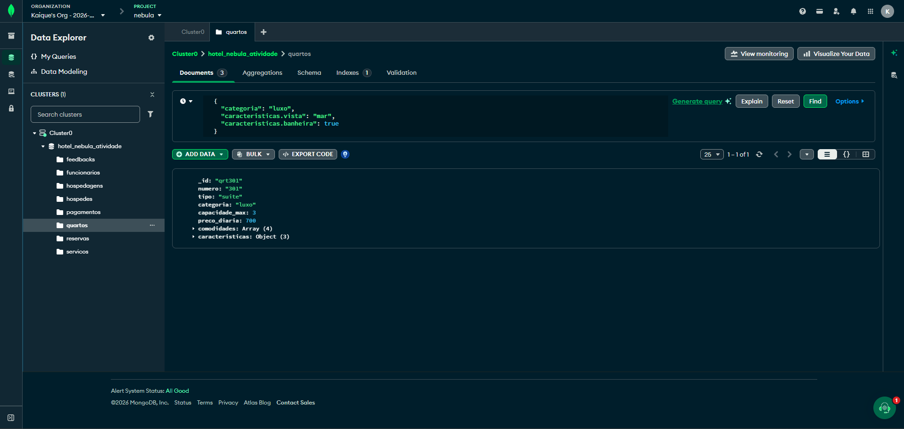
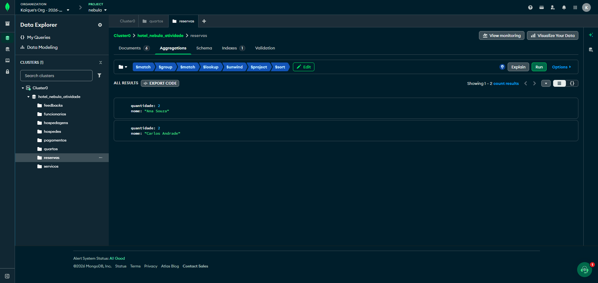
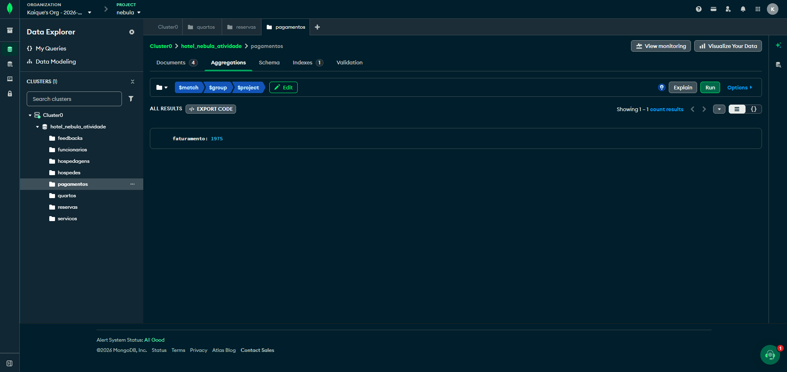
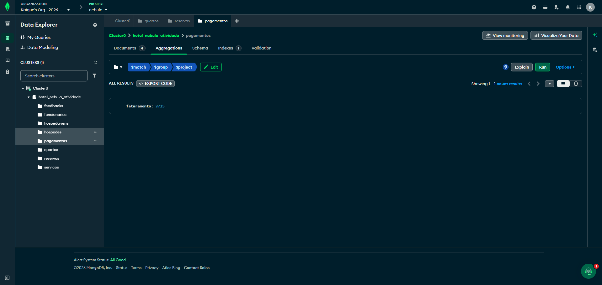
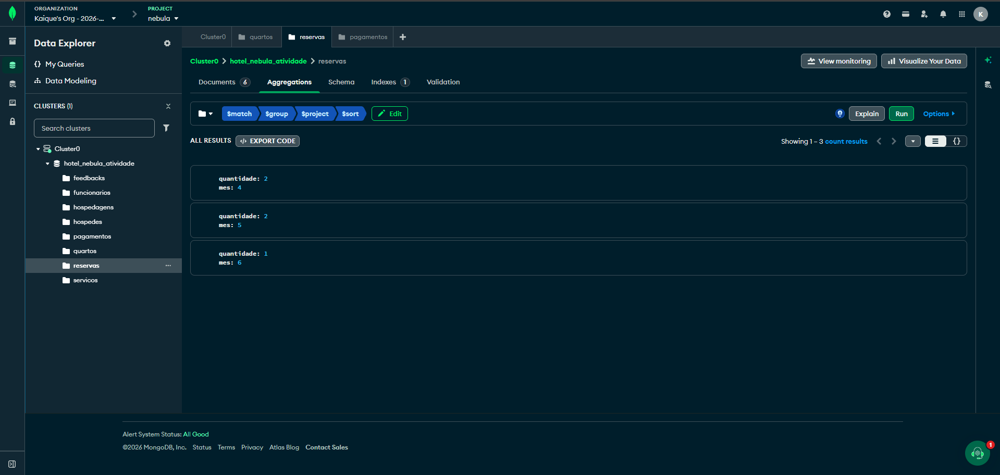
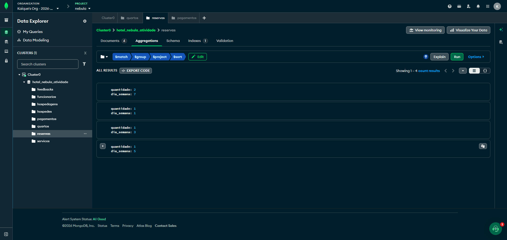

# Hotel Nebula

Os arquivos estão separados nas três partes da atividade:

- [Parte 1 - Modelagem](parte1-modelagem/): esquema e exemplos das coleções.
- [Parte 2 - Dados](parte2-dados/): documentos e script de inserção.
- [Parte 3 - Consultas](parte3-consultas/): consultas e prints dos resultados.

## Parte 1 - Origem do Sistema

O hotel precisa organizar os dados dos hóspedes, quartos, reservas, hospedagens, pagamentos, funcionários e avaliações. Escolhi o MongoDB porque ele permite guardar os dados em documentos, usando listas e objetos dentro deles.

Usei banco não relacional porque o enunciado pede coleções e documentos, mesmo citando banco relacional em uma linha da Parte 2.

### Coleções

| Coleção | O que guarda |
|---|---|
| hospedes | Nome, contato, endereço e preferências do hóspede. |
| quartos | Número, tipo, capacidade, preço e características do quarto. |
| reservas | Hóspede, quarto, datas previstas, valor e situação da reserva. |
| hospedagens | Datas reais da estadia, funcionários responsáveis e serviços consumidos. |
| pagamentos | Valor pago, data e formas de pagamento. |
| funcionarios | Nome, cargo e turno dos funcionários. |
| servicos | Nome, preço e unidade de cobrança dos serviços. |
| feedbacks | Nota, comentário do hóspede e resposta do hotel, quando houver. |

### Como organizei os dados

A reserva guarda o ID do hóspede e do quarto. Também guarda uma cópia do nome e contato do hóspede e dos dados básicos do quarto. Assim, se o cadastro mudar, ainda dá para consultar os dados que estavam na reserva.

As avaliações ficam na coleção feedbacks. Achei melhor separar porque um quarto pode receber muitas avaliações e não precisa guardar todas dentro do seu cadastro.

Os serviços consumidos ficam dentro da hospedagem, em uma lista. Cada item tem o ID do serviço, o nome, a quantidade e o preço cobrado. O catálogo fica na coleção servicos. Se o preço do catálogo mudar, o consumo antigo continua com o valor da época.

Endereço e preferências ficam dentro do hóspede porque fazem parte do cadastro dele. As comodidades ficam em uma lista dentro do quarto.

Separei reserva de hospedagem porque uma pessoa pode reservar e depois cancelar. Nesse caso, existe a reserva, mas não existe uma estadia realizada.

As ligações principais ficaram assim:

- Hóspede e quarto são ligados à reserva pelos seus IDs.
- A hospedagem guarda o ID da reserva e dos funcionários que fizeram a entrada e a saída.
- O pagamento guarda o ID da hospedagem.
- A avaliação guarda o ID do hóspede, da hospedagem e do quarto.

O esquema inicial e um documento de cada coleção estão em [schemas.md](parte1-modelagem/schemas.md). Todos os documentos de exemplo estão em [documentos.json](parte2-dados/documentos.json).

## Parte 2 - Montagem do Núcleo

O arquivo [inserir.js](parte2-dados/inserir.js) cria as oito coleções e insere os dados. Os exemplos são fictícios e usam datas de 2025.

Coloquei três hóspedes, três quartos, dois funcionários, dois serviços, seis reservas, quatro hospedagens, quatro pagamentos e três avaliações.

Também usei alguns formatos diferentes: um hóspede não tem preferências cadastradas, uma avaliação tem resposta do hotel e as outras não, um pagamento usa cartão e Pix e uma hospedagem não tem serviços extras. Isso mostra que os documentos podem ter campos opcionais sem mudar toda a coleção.

As referências evitam repetir cadastros inteiros em vários lugares. As listas e os objetos embutidos juntam informações que normalmente são consultadas juntas. Se o hotel crescer, dá para adicionar campos e consultar cada coleção separadamente. Se os consumos de uma hospedagem ficarem muito grandes, eles podem passar para uma coleção própria.

### Como executar

Com MongoDB em execução e mongosh instalado, abra o terminal nesta pasta e execute:

```powershell
mongosh "mongodb://localhost:27017" --file parte2-dados/inserir.js
mongosh "mongodb://localhost:27017" --file parte3-consultas/consultas.js
```

O banco usado é hotel_nebula_atividade. Execute a inserção apenas uma vez em um banco vazio, para não repetir os IDs. As datas do script usam UTC. O JSON é para visualizar os exemplos; a carga é feita pelo inserir.js.

### Inserir pelo site do Atlas

A pasta [importacao-atlas](parte2-dados/importacao-atlas/) contém um JSON por coleção, com todos os documentos daquela coleção em uma lista. As datas usam o formato Extended JSON para serem gravadas como datas no MongoDB.

Crie a coleção com o mesmo nome do arquivo, abra ADD DATA > Insert Document, selecione o modo JSON e cole o conteúdo inteiro do arquivo, incluindo os colchetes. Clique em Insert. Repita para cada coleção.

Cada arquivo deve ser inserido na sua coleção.

## Parte 3 - Radar de Comando

O arquivo [consultas.js](parte3-consultas/consultas.js) contém as consultas pedidas.

| Consulta | Resultado nos exemplos |
|---|---|
| Quartos de luxo com vista para o mar e banheira | Quarto 301. |
| Hóspedes que reservaram mais de uma vez | Carlos e Ana, com duas reservas cada. |
| Faturamento em abril de 2025 | R$ 1.975,00. |
| Faturamento em 2025 | R$ 3.715,00. |
| Meses com mais reservas | Abril e maio, com duas reservas cada; junho tem uma. |
| Dias da semana com mais check-ins previstos | Sábado, com dois; terça, quinta e domingo têm um cada. |

Para o faturamento, considerei somente pagamentos com status pago, usando a data do pagamento. Não somei reservas como se fossem dinheiro recebido.

Nas consultas de reservas, desconsiderei a reserva cancelada. A consulta por mês usa o mês do check-in previsto, e a de dia da semana conta chegadas previstas, incluindo a reserva confirmada. Esses dois resultados mostram o movimento de reservas, e não uma taxa de ocupação dos quartos.

Os dados foram inseridos no MongoDB Atlas e as consultas retornaram os resultados da tabela. Os prints estão abaixo.

### Consulta de quartos no Atlas

A consulta por quarto de luxo, com vista para o mar e banheira retornou o quarto 301.



### Hóspedes que reservaram mais de uma vez

A consulta retornou Ana Souza e Carlos Andrade, com duas reservas cada.



### Faturamento de abril de 2025

A soma dos pagamentos recebidos em abril retornou R$ 1.975,00.



### Faturamento de 2025

A consulta dos pagamentos recebidos em 2025 retornou R$ 3.715,00.



### Reservas por mês

A consulta retornou duas reservas em abril, duas em maio e uma em junho de 2025, sem contar a reserva cancelada.




### Check-ins previstos por dia da semana

A consulta retornou dois check-ins no sábado e um no domingo, na terça-feira e na quinta-feira.



